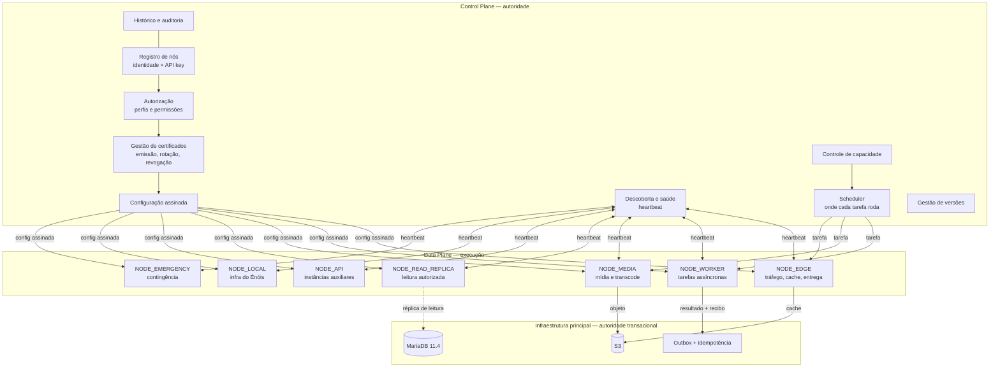
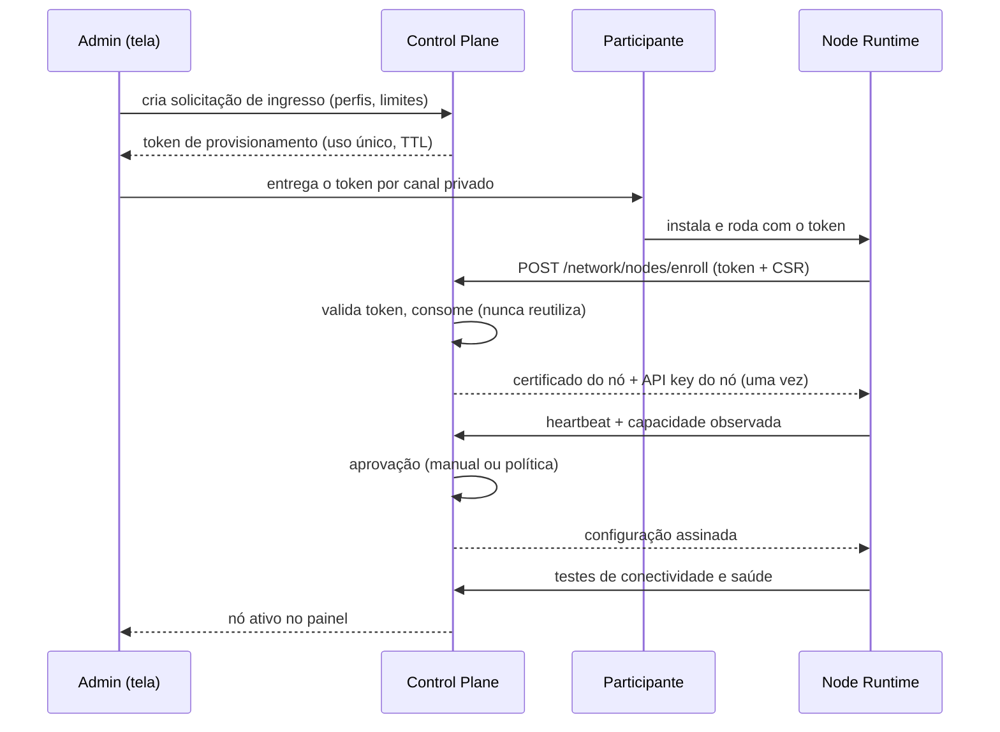
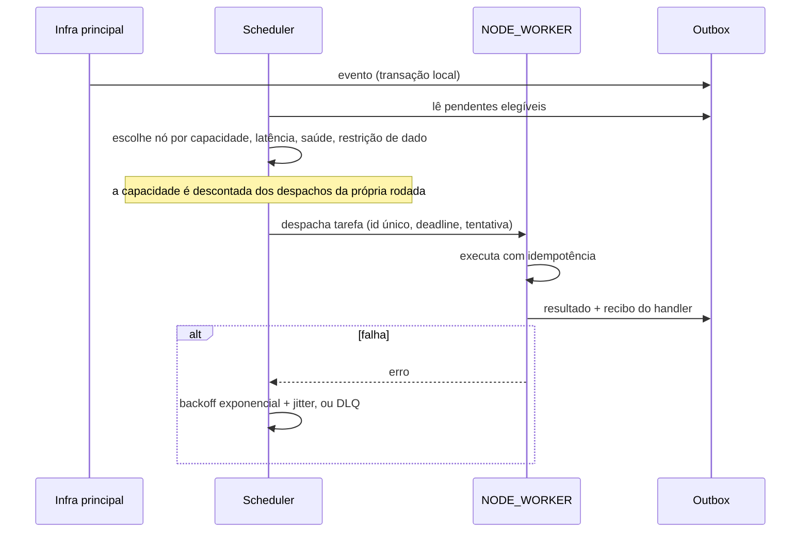

# 01 — Arquitetura da rede

## 1. Três camadas

**Regra dura:** a seta de escrita só existe de `Data Plane` para `Outbox`/`S3`. Nenhum nó externo
abre conexão de escrita no MariaDB principal. `NODE_READ_REPLICA` é a única exceção e é **somente
leitura**, com usuário próprio e escopo de tabelas.

## 2. Control Plane

Autoridade sobre identidade e permissão. Um nó auxiliar **jamais** modifica as próprias permissões,
declara-se confiável ou se promove a controlador.

| responsabilidade | onde vive na Fase 1 |
|---|---|
| registro de nós | tabela `network_nodes` (nova) |
| API key por nó | tabela `network_node_keys` (nova), só hash |
| autorização e perfis | `network_nodes.profiles` + `AdminGuard` |
| certificados | emissão no onboarding, rotação por job |
| configuração assinada | endpoint `GET /network/nodes/me/config` |
| descoberta e saúde | heartbeat + `last_seen_at` |
| capacidade | declarada no cadastro, observada no heartbeat |
| scheduler | Fase 2 |
| versões | `runtime_version` no heartbeat |
| revogação | `revoked_at` + negação imediata |
| auditoria | `audit_logs` existente |

## 3. Data Plane

Executa. Cada perfil é um contrato de permissão, não um binário diferente.

| perfil | faz | nunca faz |
|---|---|---|
| `NODE_EDGE` | cache, entrega de conteúdo, operações de borda | decidir autorização de usuário |
| `NODE_WORKER` | tarefas assíncronas, processamento intensivo | escrever no banco principal |
| `NODE_MEDIA` | transcode, otimização, conversão | ler dado pessoal fora do objeto de mídia |
| `NODE_READ_REPLICA` | leitura de dados autorizados | qualquer escrita |
| `NODE_API` | instâncias auxiliares de API | emitir sessão própria |
| `NODE_LOCAL` | infra do Énóis, absorver pico | qualquer tipo/classe de dado; **escolhido antes** dos demais entre os saudáveis ([ADR-010](../adr/ADR-010-node-local-prioridade-de-ordem.md)) | — |
| `NODE_EMERGENCY` | funções preparadas para incidente | assumir função não preparada |

Um servidor pode executar mais de um perfil se capacidade e permissões permitirem.

## 4. Node Runtime

Runtime padronizado que transforma uma máquina comum em participante. Alvos: Linux, Docker, Docker
Compose, VPS, servidor físico, máquina local, nuvem.

## 5. Fluxo de uma tarefa (Fase 2)

## 6. Onde a rede toca o que já existe

| componente atual | muda? | como |
|---|---|---|
| `OutboxWorker` | não | continua sendo o consumidor local; o scheduler é um consumidor a mais |
| `IdempotencyApplicationService` | não | reusado como está |
| `AdminGuard` / `AdminRouteInterceptor` | não | `/admin/network/**` já nasce protegido |
| `WriteRouteInterceptor` | sim, aditivo | rotas de nó entram na lista branca com credencial própria |
| `MessageStreamHub` | sim, na Fase 3 | precisa de broadcast entre instâncias antes de réplica |
| `CacheConfig` | sim, na Fase 3 | cache distribuído ou TTL mais curto com invalidação por evento |
| `MediaFfmpegRunner` | sim, na Fase 3 | passa a poder executar em `NODE_MEDIA` |
| `HealthWatcher` | não | já transforma status em evento |

## 7. O que a rede **não** é

- Não é multi-master. A escrita continua num lugar só.
- Não é blockchain nem consenso próprio.
- Não é execução de conteúdo de usuário. HTML, CSS e KofScript continuam nos sandboxes atuais.
- Não é "mais VPS rodando o mesmo jar". Cada perfil tem contrato e permissão próprios.
