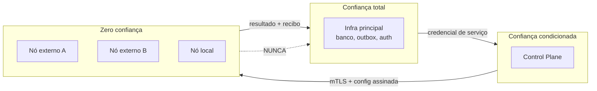

# 02 — Modelo de confiança e ameaças

## 1. Premissa central

**Um participante pode ter boas intenções e ainda assim operar uma máquina comprometida.** O modelo
não separa "nós bons" de "nós maus": todo nó é tratado como potencialmente hostil, e o que o protege
é o limite de permissão, não a reputação.

Consequência direta: **nenhum controle depende de o nó se comportar**. Toda decisão de segurança é
tomada no Control Plane ou na infraestrutura principal.

## 2. Fronteiras de confiança

`NODE_LOCAL` está em T2 de propósito: ser da casa não dá confiança automática. O que ele ganha é
prioridade de escalonamento, não permissão extra.

## 3. Ativos e o que cada um vale

| ativo | onde vive | quem pode tocar |
|---|---|---|
| credencial do banco principal | infra principal | ninguém fora dela |
| sessões de usuário | infra principal | ninguém fora dela |
| dado pessoal | infra principal | só via API autorizada |
| objeto de mídia | S3 | nó `NODE_MEDIA` só o objeto da tarefa |
| chave de nó | hash no banco | o nó, uma vez, no enroll |
| configuração assinada | Control Plane | todos os nós (é pública, mas assinada) |
| fila de tarefas | outbox | scheduler e o nó designado |

## 4. Ameaças e controles

### 4.1 Nó comprometido

| o que o atacante tenta | por que falha |
|---|---|
| ler credencial do banco | o nó nunca recebe uma; não existe caminho de rede para o banco |
| forjar identidade de outro nó | certificado individual + mTLS; a chave de um nó não autentica outro |
| alterar as próprias permissões | permissão é dado do Control Plane; o nó só lê a config assinada |
| seguir executando depois de revogado, sem falar com o Control Plane | a config assinada tem validade (`ttlSeconds`, ADR-018); passado o prazo sem revalidar, o nó para de pedir tarefa e drena |
| reutilizar token de provisionamento | token é de uso único e consumido no enroll |
| replay de requisição capturada | nonce + timestamp + request id, janela curta |
| executar tarefa de outro nó | tarefa é endereçada ao nó designado e assinada |
| esconder que está comprometido | heartbeat com versão e integridade; divergência vira alerta |

### 4.2 Nó malicioso desde o início

| o que tenta | controle |
|---|---|
| inundar o Control Plane | rate limit individual por nó, além do global |
| varrer a API | `EnumerationGuardFilter` existente + limite por nó |
| receber tarefa que não pode | autorização por perfil no despacho, não no nó |
| servir conteúdo adulterado | verificação de integridade do objeto; hash conferido na origem |
| ficar com dado de usuário | a tarefa recebe o mínimo; retenção e expiração no contrato |
| se passar por outro participante | identidade é do nó, não do dono; o dono não herda permissão |

### 4.3 Ataque à rede inteira

| vetor | controle |
|---|---|
| Control Plane fora do ar | autoridade redundante com promoção controlada (Fase 6) |
| dois controladores ao mesmo tempo | eleição com termo/epoch; nó recusa config de termo antigo |
| nó envenenando o scheduler | capacidade **observada** pesa mais que a **declarada** |
| nó declarando 1 núcleo e recebendo 12 tarefas | a vaga vem do declarado, mas a rodada desconta o que já entregou — **entregue** ([05 §7.1](05-sincronizacao.md)) |
| nó passando do teto de memória que aceitou ceder | memória observada ≥ declarada tira o nó do filtro e da conta de vagas — **entregue** ([05 §7.2](05-sincronizacao.md)) |
| nó lento derrubando o balanceamento | circuit breaker + remoção temporária por saúde real — **entregue**: latência medida e streak de falha em `network_nodes`, degradado perde prioridade, `FAILURE_STREAK_LIMIT` falhas seguidas tiram o nó por uma janela que expira sozinha ([05 §7.1](05-sincronizacao.md)) |
| revogação durante processamento | revogação é checada no despacho e no resultado; tarefa de nó revogado é descartada |

## 5. Controles obrigatórios por camada

### Identidade e comunicação
- mTLS entre nó e Control Plane; certificado individual por nó.
- Rotação automática; revogação imediata (negação no próximo handshake).
- Configuração distribuída **assinada**; nó recusa config sem assinatura válida — e a recusa é
  **verificada**, não declarada: o runtime reconstrói a linha canônica e confere a assinatura
  Ed25519 com openssl contra o X.509 **pinado** no enroll. Um Control Plane comprometido ou um
  proxy no caminho pode alterar `limits`/`allowedTasks` e copiar o campo `publicKey` do pino
  (a string viaja no mesmo corpo), mas não produz assinatura válida do pino — **entregue**
  ([04 §6.1](04-identidade-e-autorizacao.md)).
- Anti-replay: nonce, timestamp, request id.

### Isolamento
- Container isolado, usuário sem privilégio, filesystem restrito.
- Limites de CPU, memória, disco e rede impostos pelo runtime.
- seccomp e namespaces; AppArmor/SELinux quando disponíveis.
- **Sem** acesso ao docker socket; **sem** acesso ao host.
- Credencial separada por serviço; segregação de ambiente.

### Dados
- Nunca distribuir credencial do banco principal.
- Nunca dar acesso administrativo ao banco a nó externo.
- Minimizar dado pessoal replicado; criptografia em trânsito e em repouso.
- Não distribuir token de usuário indiscriminadamente.
- Retenção e expiração por contrato; conformidade com a LGPD.

### Conteúdo de usuário
**HTML, CSS, KofScript e qualquer conteúdo não confiável nunca executam no ambiente de um nó.**
Continuam nos sandboxes próprios, independentemente de onde a infraestrutura roda. Um nó que
processa mídia processa **bytes de mídia**, não código.

## 6. O que o modelo explicitamente aceita

1. **Um nó pode ficar offline a qualquer momento.** Toda tarefa tem deadline e retry; nada espera
   indefinidamente.
2. **Um nó pode mentir sobre capacidade.** Por isso a capacidade observada existe e pesa.
3. **Um nó pode vazar o que recebeu.** Por isso o que ele recebe é o mínimo, e o contrato diz o que
   pode ser retido.
4. **A rede pode ficar sem nós externos.** A infraestrutura principal continua funcionando sozinha;
   a rede é capacidade adicional, não dependência.

## 7. O que o modelo não promete

- Não promete que um nó comprometido não cause dano **ao que ele recebeu**. Promete que ele não
  alcança o resto.
- Não promete disponibilidade total quando a infraestrutura principal cai. Promete degradação
  declarada (ver `06-contingencia.md`).
- Não promete detecção perfeita de comportamento anômalo. Promete quarentena rápida e auditoria.
