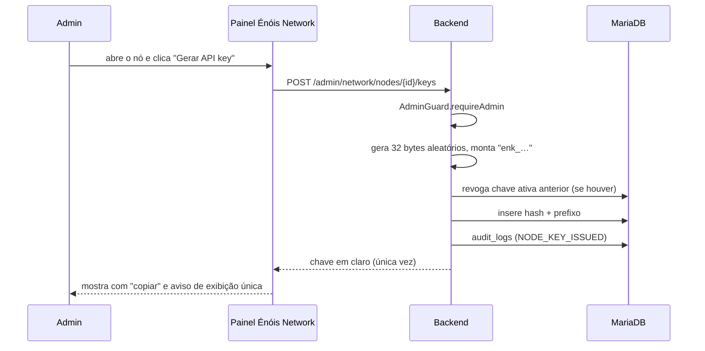
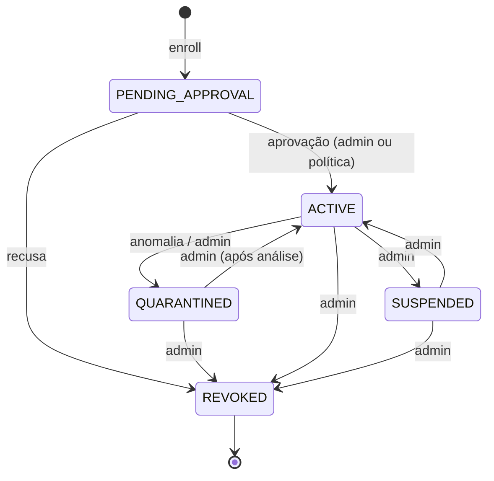

# 04 — Identidade e autorização

## 1. Duas credenciais por nó, com papéis diferentes

| credencial | o que prova | onde vive | como é emitida |
|---|---|---|---|
| **certificado do nó** (mTLS) | "esta conexão vem deste nó" | keystore do runtime | CSR no enroll, assinado pelo Control Plane |
| **API key do nó** | "este nó está autorizado a operar" | hash no banco | **gerada por um admin, na tela de administração** |

As duas são necessárias. O certificado protege o canal; a API key é a autorização administrativa e é
o que o admin revoga. Perder uma não basta para operar: sem certificado não há handshake, sem chave
não há autorização.

## 2. A API key por nó — requisito direto da dona

> "um admin deve poder cadastrar uma API key que vai conectar com os nodes, uma API key por node
> gerada na tela de admin"

Regras que a implementação precisa cumprir, todas verificáveis em teste:

1. **Uma chave por nó.** Não existe chave compartilhada entre nós. A tabela tem
   `unique (node_id)` na chave ativa.
2. **Gerada na tela de admin.** O endpoint é `POST /admin/network/nodes/{id}/keys`, sob
   `/admin/**` — portanto já coberto por `AdminRouteInterceptor` e por `AdminGuard` no controller
   (defesa em profundidade, como nas outras rotas admin).
3. **Exibida uma única vez.** A resposta do `POST` é o único lugar onde a chave em claro aparece.
   Depois disso, só o hash existe. A tela mostra a chave com botão de copiar e o aviso de que ela não
   será mostrada de novo.
4. **Armazenada só como hash.** `Hashes.sha256Hex` (o mesmo utilitário de token de uso único já
   usado no projeto). Comparação em tempo constante.
5. **Revogável.** `POST /admin/network/nodes/{id}/keys/{keyId}/revoke` marca `revoked_at`; a próxima
   requisição do nó recebe `NODE_KEY_REVOKED` (401). Revogação não espera cache expirar.
6. **Rotacionável.** Gerar chave nova revoga a anterior na mesma transação, com janela de graça
   opcional configurável (`rede.network.key-rotation-grace-minutes`, default 0).
7. **Auditada.** Toda emissão e revogação grava em `audit_logs` com ator, nó e ação. A chave em claro
   **nunca** entra na auditoria, no log nem no evento de outbox.

### Formato da chave

```
enk_<nodeIdCurto>_<32 bytes base64url>
```

O prefixo `enk_` (Énóis Network Key) permite reconhecer a chave em log e em varredura de segredo sem
revelar nada. O `nodeIdCurto` é só para diagnóstico humano; a autorização usa o hash completo.

### Modelo de dados

```sql
create table if not exists network_nodes (
  id varchar(40) not null,
  display_name varchar(120) not null,
  owner_user_id varchar(40) not null,
  status varchar(24) not null,          -- PENDING_APPROVAL | ACTIVE | SUSPENDED | QUARANTINED | REVOKED
  profiles varchar(255) not null,       -- CSV de NodeProfile
  declared_cpu_cores int not null,
  declared_memory_mb int not null,
  declared_disk_mb int not null,
  declared_bandwidth_mbps int not null,
  region varchar(64) null,
  country varchar(2) null,
  runtime_version varchar(32) null,
  certificate_fingerprint varchar(128) null,
  last_seen_at timestamp null,
  approved_by varchar(40) null,
  approved_at timestamp null,
  revoked_at timestamp null,
  created_at timestamp not null,
  primary key (id),
  key idx_network_nodes_status (status),
  key idx_network_nodes_owner (owner_user_id)
) engine=InnoDB default charset=utf8mb4 collate=utf8mb4_uca1400_ai_ci;

create table if not exists network_node_keys (
  id varchar(40) not null,
  node_id varchar(40) not null,
  key_hash char(64) not null,           -- sha256 hex; a chave em claro nunca é gravada
  key_prefix varchar(16) not null,      -- "enk_nd_ab12" para diagnóstico
  created_by varchar(40) not null,
  created_at timestamp not null,
  last_used_at timestamp null,
  revoked_at timestamp null,
  revoked_by varchar(40) null,
  primary key (id),
  unique key uk_network_node_keys_hash (key_hash),
  key idx_network_node_keys_node (node_id, revoked_at)
) engine=InnoDB default charset=utf8mb4 collate=utf8mb4_uca1400_ai_ci;
```

A chave ativa de um nó é a linha com `revoked_at is null`. A unicidade de "uma chave ativa por nó" é
garantida na aplicação dentro da transação de emissão (revoga a anterior e insere a nova), e o teste
cobre a corrida.

### Fluxo na tela de admin



## 3. Token de provisionamento

Separado da API key, e anterior a ela.

- Emitido por admin: `POST /admin/network/nodes/{id}/provision-token`.
- Uso único, TTL curto (default 30 min), só hash no banco.
- Consumido no `POST /network/nodes/enroll`; segunda tentativa recebe `NODE_TOKEN_USED` (409).
- Não confunde com a API key: o token **cria** o nó; a chave **opera** o nó.

## 4. Perfis e permissões

Permissão é dado do Control Plane. O nó lê a config assinada e obedece; ele não decide.

| perfil | tarefas permitidas | dados que pode receber |
|---|---|---|
| `NODE_EDGE` | `EDGE_CACHE`, `EDGE_DELIVER` | conteúdo público |
| `NODE_WORKER` | `ASYNC_JOB` | conforme `dataClass` da tarefa |
| `NODE_MEDIA` | `MEDIA_TRANSCODE`, `MEDIA_THUMBNAIL` | objeto de mídia da tarefa |
| `NODE_READ_REPLICA` | `READ_QUERY` | só as projeções da allowlist (`PROFILE`, `COMMUNITY`) — nunca tabela |
| `NODE_API` | `API_REQUEST` | só o que a rota autoriza |
| `NODE_LOCAL` | qualquer uma das acima | conforme perfil efetivo |
| `NODE_EMERGENCY` | só as funções preparadas | conforme preparação |

Regra de ouro: **capacidade computacional não dá permissão.** Um nó com 64 núcleos e perfil
`NODE_MEDIA` não recebe tarefa de `NODE_WORKER`.

## 5. Estados do nó



`REVOKED` é terminal. Voltar exige cadastro novo — identidade nova, chave nova. Isso é de propósito:
revogação que pode ser desfeita não é revogação.

## 6. Onde a autorização é checada

| ponto | checagem |
|---|---|
| handshake | certificado válido e não revogado |
| toda requisição de nó | `X-Node-Id` + hash da `X-Node-Key`; revogado = 401 |
| leitura da própria config | a mesma credencial, e **não** exige `status = ACTIVE` — o nó pendente precisa ler que não pode operar |
| despacho de tarefa | perfil cobre o `type` e o `dataClass` |
| resultado de tarefa | nó ainda `ACTIVE`; se revogado no meio, resultado descartado |
| rota admin | `AdminRouteInterceptor` + `AdminGuard` no controller |
| escrita sem sessão | `WriteRouteInterceptor` com lista branca explícita |

## 6.1 A config assinada

Implementada na fase 5 (`GET /network/nodes/me/config`, contrato em `03-contratos.md`).

- **Assinatura Ed25519** sobre uma linha canônica, não sobre o JSON: reordenar chaves do corpo não
  muda a assinatura, e a verificação não depende do serializador de uma biblioteca.
- **Pino**: a resposta carrega a chave pública do Control Plane. O instalador grava no enroll;
  toda config seguinte é conferida contra ela, sem confiar no transporte.
- **`configVersion` vem do ciclo de vida**, não de um contador em memória: `1` no enroll, `+1` em
  cada transição administrativa (V284). Sem isso, o `issuedAt` teria de ser o relógio da requisição
  e o runtime veria "config nova" a cada segundo.
- **`signed:false` quando não há chave configurada** — o Control Plane não inventa assinatura, e
  quem decide aceitar config sem assinatura é o runtime (padrão: recusar).
- **Nó pendente lê a própria config** (200, `operable:false`, `allowedTasks` vazio). Recusar com 403
  deixaria o instalador sem resposta no passo em que ele espera aprovação humana.

Ainda **não** implementado nesta fase: mTLS por certificado individual, CSR e rotação automática de
certificado. O modelo acima é o que existe hoje — a autoridade é a API key por nó, e a config
assinada protege o que o nó **aplica**, não o canal.

As decisões de desenho estão em [ADR-011](../adr/ADR-011-config-assinada-canonico-e-versao.md):
canônico em vez de JSON, versão da permissão vinda do ciclo de vida em vez do relógio da requisição,
e `signed:false` em vez de assinatura vazia quando não há chave.

## 7. O que nunca acontece

- A chave em claro não é gravada, logada, auditada nem publicada em evento.
- Um nó não altera o próprio perfil, estado ou chave.
- Um nó não aprova outro nó.
- Um nó não lê a chave de outro nó (só o hash existe, e o hash não autentica).
- Revogação não depende de o nó cooperar.
