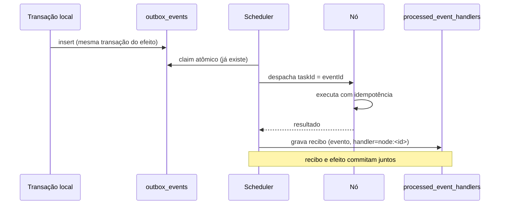

# 05 — Sincronização e consistência

## 1. Regra que não se negocia

**A infraestrutura principal é a autoridade transacional.** Nenhum nó externo escreve no banco
principal. Não existe multi-master. Qualquer evolução para escrita distribuída exigiria estratégia
formal de consenso, particionamento, conflito, recuperação e garantia de consistência — e não está
no escopo.

## 2. Classificação dos dados

| classe | exemplo | pode sair da infra principal? | como |
|---|---|---|---|
| transacional | post, comentário, voto, mensagem | **não** | só via API autorizada, nunca replicado |
| leitura | projeção pública de perfil, vitrine | sim, com escopo | `NODE_READ_REPLICA` com allowlist |
| cache | feed montado, contagem | sim | `NODE_EDGE`, TTL curto, invalidado por evento |
| evento | `PostCreated`, `MediaUploaded` | sim | outbox → scheduler → nó |
| tarefa assíncrona | transcode, thumbnail | sim | despacho com id único |
| arquivo/mídia | objeto no S3 | sim | `NODE_MEDIA` recebe o objeto da tarefa |

## 3. Mecanismos, um por problema

| problema | mecanismo | já existe? |
|---|---|---|
| evento não se perde | Transactional Outbox | **sim** (`OutboxWorker`) |
| efeito não se repete | recibo por (evento, handler) | **sim** (V252) |
| comando não se repete | `Idempotency-Key` | **sim** (`IdempotencyApplicationService`) |
| ordem quando importa | `aggregate_id` + `created_at` no outbox | **sim** |
| réplica divergente | reconciliação por hash de versão | Fase 3 |
| evento duplicado na borda | dedupe por `taskId` + `attempt` | Fase 2 |
| leitura desatualizada | TTL + invalidação por evento | **sim** (Caffeine local + sinal entre instâncias, ADR-007) |

## 4. Fluxo de evento para nó

O scheduler **é um handler** do outbox, não um sistema paralelo. Isso significa que ele herda de
graça: claim entre instâncias, backoff, DLQ por `max-attempts`, métrica de backlog e retenção.

## 5. Consistência de leitura

- `NODE_READ_REPLICA` recebe **projeções**, não tabelas cruas. A allowlist é explícita e versionada
  (`ReplicaCatalogService.ALLOWLIST`): no dia 1 são `PROFILE` e `COMMUNITY`, as mesmas projeções que a
  borda entrega. O catálogo (`GET /network/replica/{kind}`) só diz **o que existe**; o corpo de cada
  item continua vindo de `GET /network/content/{kind}/{id}`, com a versão vigente e o hash do corpo —
  não há um segundo caminho de serialização para o mesmo agregado.
- A travessia é **por chave** — `(criado em, id)` — e nunca por posição. A réplica leva horas para
  percorrer o catálogo de um sistema vivo; com `offset`, apagar um item entre duas páginas puxa os
  seguintes para trás e um deles nunca é lido, e criar um empurra os seguintes para frente e outro é
  lido duas vezes. Com chave, "continua depois de (at, id)" não depende de quantos itens existem antes.
- O fim da travessia devolve `hasMore=false` **e** o cursor preenchido: `hasMore` é "há mais agora",
  o cursor é "li até aqui". Devolver cursor nulo junto com a última página faria a réplica recomeçar do
  início e rebaixar o catálogo inteiro na rodada seguinte.
- O catálogo nunca é mais largo que a vitrine. Conta suspensa, conta removida, comunidade de conta
  suspensa e comunidade com o texto do ataque ficam fora pelo **mesmo critério** da lista pública —
  decidido no módulo dono (`ProfileService.accountsVisible`, `CommunityService.communitiesVisible`) e
  aplicado em lote: uma consulta de sanção por página, não uma por item.
- Toda projeção carrega `sourceVersion` (contador monotônico por agregado). O nó serve a versão que
  tem; o cliente que exige frescor vai na infra principal.
- Divergência entre `sourceVersion` do nó e da origem vira alerta `SYNC_DIVERGENCE` no painel.
- **Nunca** se promete leitura linearizável de réplica. O contrato diz "eventualmente consistente,
  com versão visível".

## 6. Cache distribuído

O cache é Caffeine por processo (`CacheConfig`). Invalidar num pod não invalidava os outros; desde a
Fase 3, cada limpeza também vira sinal em `network_instance_signals` e as outras instâncias limpam o
próprio cache em ~1 segundo ([ADR-007](../adr/ADR-007-broadcast-entre-instancias-por-tabela.md)) —
o TTL continua sendo a garantia, o sinal é a aceleração. Para a rede:

1. **Fase 3, passo 1 — entregue:** cache de borda só para conteúdo **público e imutável por versão**
   (ex.: objeto de mídia já publicado). Imutável não precisa de invalidação.
2. **Fase 3, passo 2 — entregue (V283):** conteúdo mutável entra com TTL curto e um **feed de
   mudanças** que diz ao nó o que revalidar. O feed (`GET /network/content/changes`) devolve, para o
   cursor `seq` que o nó informa, as versões cunhadas depois dele — `kind`, `contentId`, `version`,
   `contentHash`, `seq` — e nunca o corpo: quem entrega corpo continua sendo `GET /network/content/{kind}/{id}`,
   com a credencial de nó. A linha do feed é gravada **na mesma transação** da versão (V279), senão
   uma mudança cunhada sem linha ficaria invisível para todo nó até o TTL — ou para sempre, se o
   agregado nunca mais fosse editado.
   - **Por que cursor e não "lista de ids mudados desde X":** `seq` é monotônica e estritamente
     crescente; `updated_at` empata no milissegundo e o nó pularia ou releria a linha do empate. A
     posição pertence ao leitor (o mesmo padrão da V278): não há coluna de consumo por nó.
   - **Poda e `reset`:** o feed é janela, não histórico. `ContentChangeRetentionWorker` apaga em lotes
     o que passou de `rede.network.content.changes.retention-hours` (72 h por padrão). Um cursor que
     ficou atrás da menor posição retida recebe `reset=true` e lista vazia — **nunca** "nada mudou",
     que deixaria o nó servindo conteúdo velho achando que está em dia. Cursor `0` é "nunca
     sincronizei", não "perdi posição": recebe a página normal, sem reset.
   - **Remoção de agregado não vira linha no feed.** O feed só carrega versão cunhada, e versão só é
     cunhada sobre corpo existente. O nó descobre que um agregado sumiu ao revalidar e receber 404; a
     reconciliação (V281) fecha o ciclo pelo outro lado. Um tombstone por nó multiplicaria linhas para
     dizer a mesma coisa.
   - **O consumidor do feed está entregue no nó.** `node-runtime.sh` executa `EDGE_CACHE`: lê
     `?cursor=<seq guardado>` do arquivo `$NODE_HOME/edge/cursor`, baixa só o que mudou pelo mesmo
     `GET /network/content/{kind}/{id}` (com `?version=` quando já tem o corpo — `changed=false` não
     reescreve nem reconfirma), guarda corpo e versão em `$NODE_HOME/edge/<kind>/` e confirma
     `/synced`. O cursor **só avança com a entrada em disco**: consumir a mudança sem baixar o corpo
     deixaria a entrada velha até o TTL. `reset=true` apaga o cache e recomeça do zero; 404 apaga a
     entrada. Falha no meio devolve `complete=false` com o cursor, e a próxima tarefa retoma.
   - **A tarefa que alimenta o consumidor é por nó.** O cursor é do disco do nó, então `EDGE_CACHE`
     nasce com alvo (`network_tasks.target_node_id`, V287) e o despacho a trata como filtro: só o nó
     alvo a recebe. Sem alvo, a designação por mérito mandaria a tarefa a um nó sorteado, que
     avançaria só o próprio cursor — os outros de borda nunca sairiam do frio. Quem cria a tarefa é
     `EdgeCacheService`: pedido explícito do admin (`POST /admin/network/nodes/{id}/edge-cache`) ou
     aquisição periódica (`EdgeCacheWorker`, 2 min) para cada nó de borda vivo sem pedido em aberto.
   - **A entrega é verificada, não declarada.** `node-runtime.sh` executa também `EDGE_DELIVER`: o
     nó revalida a entrada com `?version=`, baixa o corpo quando a origem está à frente, **grava
     antes de confirmar** e reconfirma `/synced` — sem isso o veredicto atestaria o cache antigo, não
     o estado atual. O veredicto é `{"kind","contentId","version","contentHash","deliverable",
     "source":"cache|refetched"}`; 404 na origem vira `deliverable:false` com `CONTENT_GONE` e a
     entrada local é descartada. Quem pede é `EdgeDeliverService`
     (`POST /admin/network/nodes/{id}/edge-deliver`), sempre **com alvo**: a entrega é do nó
     específico, e o snapshot que a comprova é o daquele nó. O Control Plane não aceita o veredicto
     pela declaração — compara versão e hash com o que o próprio nó registrou em
     `network_content_snapshots` (`EDGE_DELIVER_UNCONFIRMED`/`EDGE_DELIVER_MISMATCH`). O nó não abre
     porta: entrega aqui é "consigo entregar isto agora", e o modelo continua pull.
3. **Nunca:** cache de dado pessoal em nó externo.

## 7. Reconciliação

O job periódico (`ContentReconcileWorker`) compara, por agregado replicado, o que o nó declarou
ter em `network_content_snapshots` com o que a origem serve agora:

- **hash igual** → nada registrado além de `checked_at` (o nó foi conferido);
- **hash diferente** → `CONTENT_STALE`. É hash e não `sourceVersion` porque versão igual com corpo
  diferente seria o pior caso: o nó acharia que está em dia;
- **agregado sumiu da origem** (404 — perfil banido, comunidade excluída) → `CONTENT_GONE`;
- **origem não respondeu** por outro motivo → `CONTENT_UNREADABLE`. Não é culpa do nó, e chamar
  isso de "sumiu" faria o painel acusar o nó por um problema do Control Plane.

A varredura **não depende de o nó cooperar**: ela usa o que o Control Plane já registrou no sync. Um
nó que nunca chama `POST /network/content/reconcile` — por bug, por comprometimento ou por não ter
implementado — é conferido igual. Se o nó mentiu sobre o que guardou, a varredura não tem como
saber; mas mentir sobre o próprio cache não dá poder, e a divergência aparece assim que a origem
muda.

A trilha de auditoria registra a **transição**, não a rodada: `SYNC_DIVERGENCE` na entrada em
divergência e `SYNC_RECOVERED` na volta ao estado em dia. Um nó parado por uma hora gera uma linha,
não doze. O estado vigente e a hora em que divergiu ficam na linha do snapshot, que é o que o
painel `/admin/network/content/divergences` lê.

A fila é ordenada por "nunca conferido, depois o mais antigo" e limitada por lote, então rodadas
sucessivas cobrem todos os agregados de um nó grande sem segurar o banco. Nós que não estão `ACTIVE`
ficam fora da fila (join com `network_nodes`): suas linhas nunca conferidas ocupariam o lote em toda
rodada e os nós ativos nunca seriam alcançados.

O estado é gravado por uma condição no motivo anterior (`coalesce(divergence_reason, '') = ?`), então
duas instâncias do Control Plane rodando a varredura ao mesmo tempo não duplicam auditoria: só a que
encontra a linha no estado esperado grava.

**Fora do escopo atual:** "nó à frente" não é caso deste desenho — a versão é cunhada pelo Control
Plane, não pelo nó, e o nó não escreve versão. Colocar nó em quarentena por divergência continua
sendo decisão administrativa (a rede alerta, não pune sozinha).

## 7.1 Balanceamento por saúde medida

O scheduler escolhe o nó em duas etapas: **filtro** e **ordem**.

O filtro exclui quem não pode receber a tarefa agora: nó morto (heartbeat velho), nó **fora do
balanceamento** (janela de remoção vigente), perfil que não cobre o tipo, classe de dado que não pode
sair da infra autorizada, sem vaga, CPU saturada e **memória declarada esgotada**.

A ordem é por **saúde e depois por folga**: nó saudável antes de nó degradado; dentro do mesmo grupo,
quem tem mais vagas livres proporcionalmente. Empate é resolvido por jitter, senão o primeiro da
lista viraria gargalo.

Saúde é **medida**, não declarada, e mora em quatro colunas de `network_nodes` (V282):

| coluna | o que é | quem escreve |
|---|---|---|
| `observed_latency_ms` | média móvel do tempo entre designação e conclusão | o Control Plane, ao aceitar um resultado DONE |
| `consecutive_failures` | resultados falhos seguidos; um sucesso zera | o Control Plane, ao aceitar um resultado |
| `quarantined_until` | fim da janela de remoção temporária | o Control Plane, ao atingir o streak |
| `quarantine_reason` | por que saiu (`FAILURE_STREAK`) | idem |

**Degradado ≠ removido.** Nó lento (acima de `SLOW_LATENCY_MS`) ou com falhas abaixo do limite é
degradado: perde prioridade, mas continua recebendo quando é o que sobrou — ele ainda entrega, e
tirá-lo do ar seria desproporcional. Nó com `FAILURE_STREAK_LIMIT` falhas seguidas é removido: sai da
lista por uma janela. Removido é filtro, não penalidade, porque com um único nó na rede uma
penalidade só o colocaria no fim da fila e ele continuaria recebendo até esgotar as tentativas de
cada tarefa.

**A remoção expira sozinha.** O filtro já considera a janela vencida como "em balanceamento"; a
varredura `NodeHealthWorker` limpa a linha e o streak e audita `NETWORK_NODE_RELEASED`. Sem ela, o
primeiro erro depois da volta tiraria o nó de novo na hora, porque o streak continuaria no limite.

**Estado de saúde não é `status`.** `SUSPENDED` é decisão humana e não expira; quarentena é
operacional e expira. Misturar os dois faria o painel dizer "suspenso" para um nó que ninguém
suspendeu, e o admin teria de "religar" o que nunca desligou.

Consequência no modo da rede: nó removido **não conta vaga** em `availableCapacity`. Contar faria a
razão fila/vagas parecer folgada e a rede não entraria em `HIGH_LOAD` justamente quando tem menos
capacidade do que aparenta. Nó saturado e nó no teto de memória declarada seguem a mesma regra.

### 7.2 Limites que o participante declara

O nó declara no enroll quanto cede de CPU, memória, disco e banda. Declarado é **teto**, não
estimativa: é o que o participante aceitou ceder, e designar tarefa a partir dele é passar por cima
do combinado — o container do nó estoura e a tarefa morre com ele.

| limite declarado | como a rede respeita |
|---|---|
| `cpuCores` | vira `concurrencyLimit()`; o despacho desconta o que a rodada já entregou |
| `memoryMb` | `memoryExhausted()`: memória observada ≥ teto declarado tira o nó do filtro e da conta de vagas |
| `diskMb` | teto do estado de conteúdo no volume do nó (`edge/` + `replica/`); o runtime mede antes de gravar — ver a seção seguinte |
| `bandwidthMbps` | teto de taxa das transferências de corpo do runtime (`--limit-rate` no curl, `Mbps × 125` kB/s) — ver §7.3 |

**Sem reporte, o nó continua elegível.** Não medir não é estar cheio: um nó que não manda
`memoryMb` no heartbeat não tem o que comparar com o teto, e excluí-lo puniria o runtime antigo por
um dado que ele nunca prometeu mandar. Teto zero segue a mesma lógica do piso 1 em
`concurrencyLimit()`: cadastro mal preenchido não pode virar nó inútil.

### 7.1 O teto de disco é aplicado por quem escreve

`limits.diskMb` viaja assinado na config (`NetworkConfigService.forNode`), mas quem escreve no
volume é o runtime do nó, e é lá que o teto vale. Duas regras porque os dois estados de conteúdo
têm promessas diferentes:

- **Borda é cache.** `EDGE_CACHE` e a releitura do `EDGE_DELIVER` gravam `edge/<kind>/<id>.json`.
  No teto, a entrada mais antiga (mtime) é evictada até a nova caber: cache completo é cache útil,
  e a borda se recompõe da origem. Se o corpo novo não cabe nem com o cache vazio, a entrada fica
  fora e o resultado conta em `dropped` — nunca em `unchanged`, porque dizer "em dia" sobre o que
  não está guardado seria mentira no painel.
- **Réplica é catálogo.** Apagar um agregado que o nó prometeu ter é quebrar a promessa em
  silêncio. No teto, a travessia para com `complete:false` e `diskFull:true`, e o cursor **não
  avança** sobre o item não gravado — retomar de onde parou é o único jeito de não pular um
  agregado. Sob pressão, a réplica pode evictar **cache da borda**, nunca a si mesma.
- **Identidade não entra na conta.** `node.json`, `api-key` e `pinning-key` não são conteúdo:
  contá-los deixaria um estouro de cache apagar a credencial e desligar o nó sozinho.

`diskMb: 0` continua significando "não declarou limite" — o nó grava, porque ausência de campo não
é ordem de parar de servir.

### 7.3 O teto de banda é aplicado por quem transfere

`limits.bandwidthMbps` é o que o participante aceitou ceder de **rede**, e o runtime é quem
transfere: baixar corpo de conteúdo (`READ_QUERY`, `EDGE_CACHE`, `EDGE_DELIVER`) e subir o
resultado do transcode (`MEDIA_TRANSCODE`, nas duas pontas) passam pelo mesmo teto, aplicado como
`curl --limit-rate`, com `Mbps × 125` kB/s (1 Mbps = 1000/8 kbit-s = 125 kB/s).

- **Um limite por transferência é o agregado que importa.** O runtime executa uma tarefa por
  ciclo, então não há duas transferências concorrentes do mesmo nó competindo pelo mesmo teto;
  limitar cada uma é limitar o nó. Se o modelo mudar para execução concorrente, o teto precisa
  virar taxa compartilhada — está registrado aqui para não ser esquecido.
- **A chamada de controle não é limitada.** Heartbeat, config, poll, catálogo de réplica e
  confirmação `/synced` são metadados pequenos; limitá-los atrasaria a própria operação do nó sem
  economizar banda de verdade.
- **`0` é "não declarei", não "zero de banda".** Quem não declarou transfere sem `--limit-rate`:
  inventar limite que o participante nunca aceitou puniria o runtime que só não mandou o campo.
- **O limite é da saída do nó.** O conteúdo vem do Control Plane, mas a taxa é medida no nó — é
  ele que paga a conta de rede que declarou, e é o único ponto onde o número declarado vira
  comportamento observável.

## 8. O que fica de fora, e por quê

| tentação | por que não |
|---|---|
| réplica de escrita | conflito sem estratégia formal; risco de perda de dado |
| consenso próprio (Raft/Paxos caseiro) | "não implementar consenso distribuído sem necessidade comprovada" |
| CDC completo no dia 1 | o outbox já cobre o que a rede precisa; CDC entra só se a projeção exigir |
| banco por região | dado pessoal fora de controle; viola soberania de dados |
