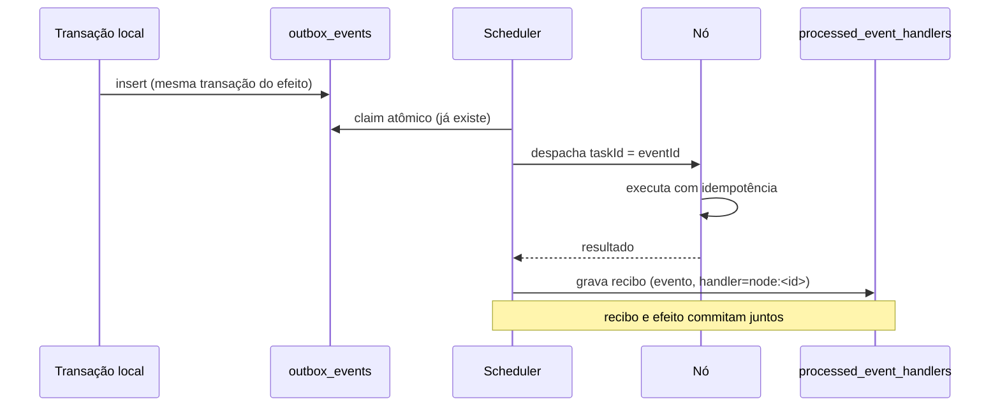

# 05 — Sincronização e consistência

## 1. Regra que não se negocia

**A infraestrutura principal é a autoridade transacional.** Nenhum nó externo escreve no banco
principal. Não existe multi-master. Qualquer evolução para escrita distribuída exigiria estratégia
formal de consenso, particionamento, conflito, recuperação e garantia de consistência — e não está
no escopo.

## 2. Classificação dos dados

| classe | exemplo | pode sair da infra principal? | como |
|---|---|---|---|
| transacional | post, comentário, voto, mensagem | **não** | só via API autorizada, nunca replicado |
| leitura | projeção pública de perfil, vitrine | sim, com escopo | `NODE_READ_REPLICA` com allowlist |
| cache | feed montado, contagem | sim | `NODE_EDGE`, TTL curto, invalidado por evento |
| evento | `PostCreated`, `MediaUploaded` | sim | outbox → scheduler → nó |
| tarefa assíncrona | transcode, thumbnail | sim | despacho com id único |
| arquivo/mídia | objeto no S3 | sim | `NODE_MEDIA` recebe o objeto da tarefa |

## 3. Mecanismos, um por problema

| problema | mecanismo | já existe? |
|---|---|---|
| evento não se perde | Transactional Outbox | **sim** (`OutboxWorker`) |
| efeito não se repete | recibo por (evento, handler) | **sim** (V252) |
| comando não se repete | `Idempotency-Key` | **sim** (`IdempotencyApplicationService`) |
| ordem quando importa | `aggregate_id` + `created_at` no outbox | **sim** |
| réplica divergente | reconciliação por hash de versão | Fase 3 |
| evento duplicado na borda | dedupe por `taskId` + `attempt` | Fase 2 |
| leitura desatualizada | TTL + invalidação por evento | parcial (Caffeine local) |

## 4. Fluxo de evento para nó

O scheduler **é um handler** do outbox, não um sistema paralelo. Isso significa que ele herda de
graça: claim entre instâncias, backoff, DLQ por `max-attempts`, métrica de backlog e retenção.

## 5. Consistência de leitura

- `NODE_READ_REPLICA` recebe **projeções**, não tabelas cruas. A allowlist é explícita e versionada.
- Toda projeção carrega `sourceVersion` (contador monotônico por agregado). O nó serve a versão que
  tem; o cliente que exige frescor vai na infra principal.
- Divergência entre `sourceVersion` do nó e da origem vira alerta `SYNC_DIVERGENCE` no painel.
- **Nunca** se promete leitura linearizável de réplica. O contrato diz "eventualmente consistente,
  com versão visível".

## 6. Cache distribuído

Hoje o cache é Caffeine por processo (`CacheConfig`), e o próprio código avisa que invalidar num pod
não invalida os outros. Para a rede:

1. **Fase 3, passo 1:** cache de borda só para conteúdo **público e imutável por versão** (ex.: objeto
   de mídia já publicado). Imutável não precisa de invalidação.
2. **Fase 3, passo 2:** conteúdo mutável entra com TTL curto e invalidação por evento de outbox
   (`CacheInvalidated`), com o nó descartando a entrada ao receber.
3. **Nunca:** cache de dado pessoal em nó externo.

## 7. Reconciliação

Job periódico compara, por agregado replicado, o `sourceVersion` da origem com o do nó:

- igual → nada;
- nó atrás → reenvia a projeção;
- nó à frente (impossível por desenho) → nó é colocado em quarentena e o caso vai para auditoria.

## 8. O que fica de fora, e por quê

| tentação | por que não |
|---|---|
| réplica de escrita | conflito sem estratégia formal; risco de perda de dado |
| consenso próprio (Raft/Paxos caseiro) | "não implementar consenso distribuído sem necessidade comprovada" |
| CDC completo no dia 1 | o outbox já cobre o que a rede precisa; CDC entra só se a projeção exigir |
| banco por região | dado pessoal fora de controle; viola soberania de dados |
