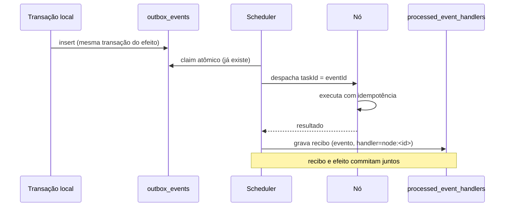

# 05 — Sincronização e consistência

## 1. Regra que não se negocia

**A infraestrutura principal é a autoridade transacional.** Nenhum nó externo escreve no banco
principal. Não existe multi-master. Qualquer evolução para escrita distribuída exigiria estratégia
formal de consenso, particionamento, conflito, recuperação e garantia de consistência — e não está
no escopo.

## 2. Classificação dos dados

| classe | exemplo | pode sair da infra principal? | como |
|---|---|---|---|
| transacional | post, comentário, voto, mensagem | **não** | só via API autorizada, nunca replicado |
| leitura | projeção pública de perfil, vitrine | sim, com escopo | `NODE_READ_REPLICA` com allowlist |
| cache | feed montado, contagem | sim | `NODE_EDGE`, TTL curto, invalidado por evento |
| evento | `PostCreated`, `MediaUploaded` | sim | outbox → scheduler → nó |
| tarefa assíncrona | transcode, thumbnail | sim | despacho com id único |
| arquivo/mídia | objeto no S3 | sim | `NODE_MEDIA` recebe o objeto da tarefa |

## 3. Mecanismos, um por problema

| problema | mecanismo | já existe? |
|---|---|---|
| evento não se perde | Transactional Outbox | **sim** (`OutboxWorker`) |
| efeito não se repete | recibo por (evento, handler) | **sim** (V252) |
| comando não se repete | `Idempotency-Key` | **sim** (`IdempotencyApplicationService`) |
| ordem quando importa | `aggregate_id` + `created_at` no outbox | **sim** |
| réplica divergente | reconciliação por hash de versão | Fase 3 |
| evento duplicado na borda | dedupe por `taskId` + `attempt` | Fase 2 |
| leitura desatualizada | TTL + invalidação por evento | **sim** (Caffeine local + sinal entre instâncias, ADR-007) |

## 4. Fluxo de evento para nó

O scheduler **é um handler** do outbox, não um sistema paralelo. Isso significa que ele herda de
graça: claim entre instâncias, backoff, DLQ por `max-attempts`, métrica de backlog e retenção.

## 5. Consistência de leitura

- `NODE_READ_REPLICA` recebe **projeções**, não tabelas cruas. A allowlist é explícita e versionada.
- Toda projeção carrega `sourceVersion` (contador monotônico por agregado). O nó serve a versão que
  tem; o cliente que exige frescor vai na infra principal.
- Divergência entre `sourceVersion` do nó e da origem vira alerta `SYNC_DIVERGENCE` no painel.
- **Nunca** se promete leitura linearizável de réplica. O contrato diz "eventualmente consistente,
  com versão visível".

## 6. Cache distribuído

O cache é Caffeine por processo (`CacheConfig`). Invalidar num pod não invalidava os outros; desde a
Fase 3, cada limpeza também vira sinal em `network_instance_signals` e as outras instâncias limpam o
próprio cache em ~1 segundo ([ADR-007](../adr/ADR-007-broadcast-entre-instancias-por-tabela.md)) —
o TTL continua sendo a garantia, o sinal é a aceleração. Para a rede:

1. **Fase 3, passo 1:** cache de borda só para conteúdo **público e imutável por versão** (ex.: objeto
   de mídia já publicado). Imutável não precisa de invalidação.
2. **Fase 3, passo 2:** conteúdo mutável entra com TTL curto e invalidação por evento de outbox
   (`CacheInvalidated`), com o nó descartando a entrada ao receber.
3. **Nunca:** cache de dado pessoal em nó externo.

## 7. Reconciliação

O job periódico (`ContentReconcileWorker`) compara, por agregado replicado, o que o nó declarou
ter em `network_content_snapshots` com o que a origem serve agora:

- **hash igual** → nada registrado além de `checked_at` (o nó foi conferido);
- **hash diferente** → `CONTENT_STALE`. É hash e não `sourceVersion` porque versão igual com corpo
  diferente seria o pior caso: o nó acharia que está em dia;
- **agregado sumiu da origem** (404 — perfil banido, comunidade excluída) → `CONTENT_GONE`;
- **origem não respondeu** por outro motivo → `CONTENT_UNREADABLE`. Não é culpa do nó, e chamar
  isso de "sumiu" faria o painel acusar o nó por um problema do Control Plane.

A varredura **não depende de o nó cooperar**: ela usa o que o Control Plane já registrou no sync. Um
nó que nunca chama `POST /network/content/reconcile` — por bug, por comprometimento ou por não ter
implementado — é conferido igual. Se o nó mentiu sobre o que guardou, a varredura não tem como
saber; mas mentir sobre o próprio cache não dá poder, e a divergência aparece assim que a origem
muda.

A trilha de auditoria registra a **transição**, não a rodada: `SYNC_DIVERGENCE` na entrada em
divergência e `SYNC_RECOVERED` na volta ao estado em dia. Um nó parado por uma hora gera uma linha,
não doze. O estado vigente e a hora em que divergiu ficam na linha do snapshot, que é o que o
painel `/admin/network/content/divergences` lê.

A fila é ordenada por "nunca conferido, depois o mais antigo" e limitada por lote, então rodadas
sucessivas cobrem todos os agregados de um nó grande sem segurar o banco. Nós que não estão `ACTIVE`
ficam fora da fila (join com `network_nodes`): suas linhas nunca conferidas ocupariam o lote em toda
rodada e os nós ativos nunca seriam alcançados.

O estado é gravado por uma condição no motivo anterior (`coalesce(divergence_reason, '') = ?`), então
duas instâncias do Control Plane rodando a varredura ao mesmo tempo não duplicam auditoria: só a que
encontra a linha no estado esperado grava.

**Fora do escopo atual:** "nó à frente" não é caso deste desenho — a versão é cunhada pelo Control
Plane, não pelo nó, e o nó não escreve versão. Colocar nó em quarentena por divergência continua
sendo decisão administrativa (a rede alerta, não pune sozinha).

## 8. O que fica de fora, e por quê

| tentação | por que não |
|---|---|
| réplica de escrita | conflito sem estratégia formal; risco de perda de dado |
| consenso próprio (Raft/Paxos caseiro) | "não implementar consenso distribuído sem necessidade comprovada" |
| CDC completo no dia 1 | o outbox já cobre o que a rede precisa; CDC entra só se a projeção exigir |
| banco por região | dado pessoal fora de controle; viola soberania de dados |
