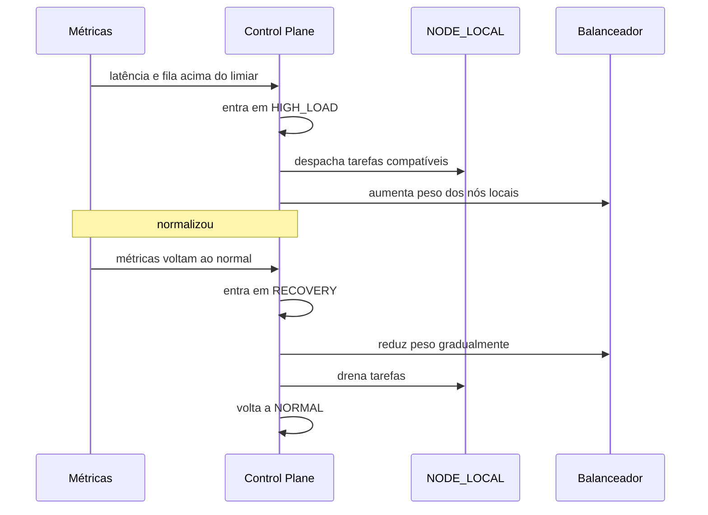

# 06 — Contingência

## 1. Modos operacionais

O modo é **dado do Control Plane**, não decisão de nó. Todo nó recebe o modo vigente no heartbeat e
na config assinada.

| modo | quando | o que muda |
|---|---|---|
| `NORMAL` | operação padrão | tudo como hoje |
| `HIGH_LOAD` | tráfego acima do esperado | distribuição ampliada; nós auxiliares recebem mais tarefas |
| `DEGRADED` | dependência crítica instável | funcionalidades não essenciais desligadas, declaradas |
| `EMERGENCY` | infra principal indisponível ou sobrecarregada | nós de contingência assumem funções preparadas |
| `RECOVERY` | voltando ao normal | retorno gradual, com drenagem dos nós auxiliares |

### O que continua disponível em cada modo

| funcionalidade | NORMAL | HIGH_LOAD | DEGRADED | EMERGENCY | RECOVERY |
|---|---|---|---|---|---|
| login e sessão | sim | sim | sim | **não** (depende do banco) | sim |
| feed (leitura) | sim | sim | sim | cache de borda, se houver | sim |
| publicar | sim | sim | sim | não | sim |
| mensagens | sim | sim | sim | não | sim |
| mídia (leitura) | sim | sim | sim | sim (S3/CDN) | sim |
| mídia (upload) | sim | sim | sim | não | sim |
| moderação | sim | sim | sim | não | sim |
| tarefas assíncronas | sim | sim | adiadas | adiadas | retomando |

**Não se promete disponibilidade total quando dependência crítica está fora.** O modo `EMERGENCY`
existe para dizer com honestidade o que continua de pé.

## 2. Contingência local (prioritária)

Critérios de entrada e saída são **medidos**, não intuídos: latência p95, profundidade de fila,
taxa de erro e uso de CPU/memória. Cada transição é registrada em auditoria com o número que a
motivou.

## 3. Contingência distribuída

Nós externos previamente autorizados assumem funções emergenciais quando a região principal sofre
indisponibilidade.

Pré-requisitos, todos obrigatórios:

- replicação geográfica do que pode ser replicado (conteúdo público, cache, mídia);
- recuperação de configuração (config assinada versionada, disponível offline no nó);
- health check externo independente da região principal;
- failover de DNS ou da camada de roteamento;
- recuperação de filas (outbox replicada ou reconstruível);
- procedimentos de recuperação de dados documentados;
- **prevenção de split-brain**.

## 4. Anti split-brain

O Control Plane não pode ser ponto único de falha sem estratégia de recuperação. A estratégia é
**autoridade redundante com promoção controlada**:

1. Cada autoridade tem um `term` (contador monotônico).
2. Um nó aceita config apenas de `term` maior ou igual ao último visto; config de `term` menor é
   recusada e registrada.
3. Promoção exige quórum explícito de autoridades vivas; sem quórum, **ninguém promove** (fail
   secure: melhor ficar sem controlador do que ter dois).
4. Dois controladores com o mesmo `term` é impossível por construção (o term é atribuído na
   promoção, com compare-and-set no armazenamento compartilhado).
5. Nó que detecta dois controladores com termos diferentes entra em `QUARANTINED` e para de aceitar
   tarefas até a situação resolver.

## 5. Revogação durante processamento

Cenário: o nó está executando uma tarefa e é revogado.

1. Revogação grava `revoked_at` imediatamente.
2. O resultado que chegar depois é **descartado** (`NODE_REVOKED`), com registro em auditoria.
3. A tarefa volta para a fila e é redistribuída, com `attempt` incrementado.
4. Se a tarefa tinha efeito externo, a idempotência do handler impede duplicação.

## 6. Falha do Control Plane

| cenário | comportamento |
|---|---|
| Control Plane fora por < TTL de config | nós continuam com a última config assinada |
| fora por > TTL | nós param de aceitar tarefa nova e drenam as em andamento |
| volta | nós revalidam config e term antes de retomar |
| autoridade promovida | nós recebem config de term novo e revalidam |

Nó **nunca** inventa permissão quando o Control Plane está fora. Fail secure.

## 7. Testes obrigatórios de contingência

- nó indisponível no meio de uma tarefa → redistribuição sem duplicar efeito;
- revogação durante processamento → resultado descartado, tarefa redistribuída;
- Control Plane fora → nós drenam e param, sem aceitar tarefa nova;
- dois controladores com termos diferentes → nó entra em quarentena;
- sobrecarga simultânea → `HIGH_LOAD` entra e sai pelos números medidos;
- recuperação → `RECOVERY` drena sem derrubar o que está em andamento.
