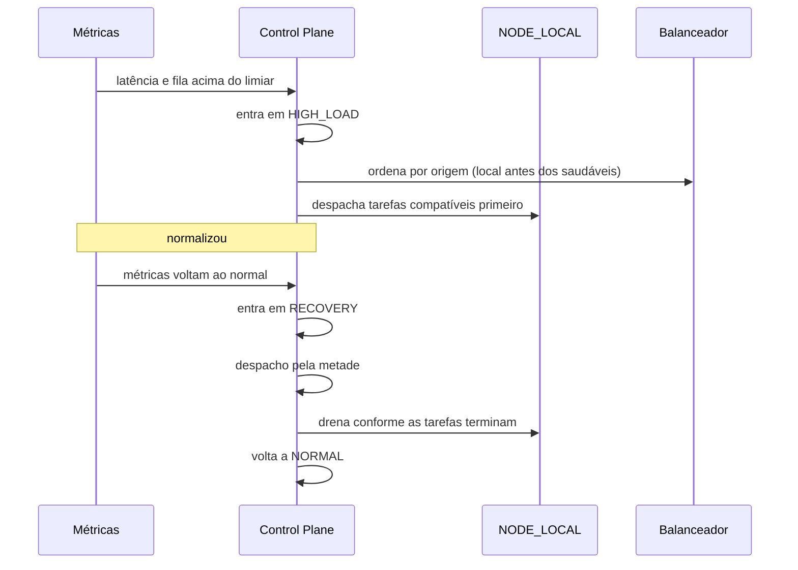

# 06 — Contingência

## 1. Modos operacionais

O modo é **dado do Control Plane**, não decisão de nó. Todo nó recebe o modo vigente no heartbeat
(campo `mode`) e, quando a config assinada existir, também nela.

| modo | quando | quem entra | o que muda |
|---|---|---|---|
| `NORMAL` | operação padrão | cálculo medido | tudo como hoje; despacho no teto da varredura |
| `HIGH_LOAD` | fila acima da capacidade | cálculo medido | **não** bloqueia nada: distribuição ampliada |
| `DEGRADED` | dependência crítica instável | admin, com motivo | **despacho novo parado**; trabalho em curso continua |
| `EMERGENCY` | infra principal indisponível | admin, com motivo | **despacho novo parado**; trabalho em curso continua |
| `RECOVERY` | voltando ao normal | admin, com motivo | **despacho pela metade**; sai sozinho quando a fila normaliza |

Duas origens de transição, e a diferença é o que impede o sistema de mentir para si mesmo:

- **Medido** (`NORMAL`, `HIGH_LOAD`): a razão fila/vagas cruza o limiar com histerese (entra em 1.0,
  sai em 0.5). Ninguém declara esses modos à mão — `POST /admin/network/mode` recusa com
  `NETWORK_MODE_NOT_MANUAL`, porque uma decisão "forçar NORMAL" seria desfeita na varredura seguinte.
- **Humano** (`DEGRADED`, `EMERGENCY`, `RECOVERY`): `POST /admin/network/mode` com motivo
  obrigatório, auditado em `NETWORK_MODE_<NOVO>` com ator, modo anterior e motivo. A automação
  **nunca** desfaz `DEGRADED`/`EMERGENCY` — ela não mede dependência externa, e encerrar o incidente
  de quem olhou é como o incidente volta.

`RECOVERY` é híbrido de propósito: começa por decisão humana e **termina por número**, quando a
fila volta abaixo do limiar de saída. Recuperação que depende de alguém lembrar de desligar vira
modo esquecido, com o despacho pela metade para sempre.

**O que exatamente muda no despacho:** `DEGRADED`/`EMERGENCY` designam zero tarefas na rodada;
`RECOVERY` designa metade do teto. O que já está designado continua com o nó — parar o despacho adia
trabalho novo, não cancela o que está na mão. A recuperação de tarefa órfã (claim vencido) roda em
**qualquer** modo: devolver à fila não é designar, e a órfã parada perderia o prazo esperando o modo
voltar.

### O que continua disponível em cada modo

| funcionalidade | NORMAL | HIGH_LOAD | DEGRADED | EMERGENCY | RECOVERY |
|---|---|---|---|---|---|
| login e sessão | sim | sim | sim | **não** (depende do banco) | sim |
| feed (leitura) | sim | sim | sim | cache de borda, se houver | sim |
| publicar | sim | sim | sim | não | sim |
| mensagens | sim | sim | sim | não | sim |
| mídia (leitura) | sim | sim | sim | sim (S3/CDN) | sim |
| mídia (upload) | sim | sim | sim | não | sim |
| moderação | sim | sim | sim | não | sim |
| tarefas assíncronas | sim | sim | adiadas | adiadas | retomando |

**Não se promete disponibilidade total quando dependência crítica está fora.** O modo `EMERGENCY`
existe para dizer com honestidade o que continua de pé.

## 2. Contingência local (prioritária)

**A prioridade do `NODE_LOCAL` é de ordenação, não de peso variável.** O escolhedor prefere o nó da
casa entre os saudáveis — depois do filtro de degradação, antes da folga. É constante e não depende
do modo: um pico não muda o critério, só aumenta o número de tarefas que passam por ele. Peso que
subisse e descesse traria um segundo conjunto de limiares para calibrar sem ganho observável — o
local já recebe primeiro até encher, e daí em diante a fila vai para os participantes de qualquer
modo.

O que o modo muda de fato é o **volume** despachado (`HIGH_LOAD` no teto da varredura, `RECOVERY`
pela metade), não a ordem. A drenagem completa — devolver trabalho ao participante sem derrubar o
que está em andamento — está entregue na forma abaixo.

### Drenagem de nó fora de operação

Quando um nó é suspenso, entra em quarentena ou é revogado, o que estava designado a ele volta para
a fila **na hora**: a varredura compara as tarefas `DISPATCHED` com o status do nó e devolve as que
estão presas a quem já não autentica. Antes disso, a única porta de saída era o claim vencer — dois
minutos no padrão —, e o nó suspenso não ia responder nesse intervalo.

Drenar não é executar diferente: a tarefa volta como `PENDING`, e o resultado do nó drenado, se
chegar, encontra status `PENDING` ou `attempt` diferente e cai no descarte que já existe. Por isso
a drenagem não precisa de regra nova de idempotência — ela reaproveita a que protege a
redistribuição desde a fase 2.

O local continua sujeito a todos os filtros: vivo, fora da janela de remoção, com vaga, não
saturado. Ele não ganha tipo de tarefa nem classe de dado que os outros não tenham — a permissão
dele vem do perfil, que já aceitava todos os tipos e é a única origem autorizada a receber dado que
não pode sair da infra autorizada. Prioridade de escalonamento é onde ele entra na ordem, não o que
ele pode tocar.

Critérios de entrada e saída são **medidos**, não intuídos: latência p95, profundidade de fila,
taxa de erro e uso de CPU/memória. Cada transição automática é registrada em auditoria com o número
que a motivou (`NETWORK_MODE_HIGH_LOAD` com `pending` e `capacity`; `NETWORK_MODE_NORMAL` na saída de
`RECOVERY`); cada transição manual guarda o motivo declarado.

O nó descobre o freio pelo heartbeat: `mode` e `acceptTasks` (falso em `DEGRADED`/`EMERGENCY`). Sem
esses dois campos a contingência existiria só no painel — o nó pediria tarefa no escuro e o
`EMERGENCY` não teria efeito nenhum em quem está executando.

## 3. Contingência distribuída

Nós externos previamente autorizados assumem funções emergenciais quando a região principal sofre
indisponibilidade.

Pré-requisitos, todos obrigatórios:

- replicação geográfica do que pode ser replicado (conteúdo público, cache, mídia);
- recuperação de configuração (config assinada versionada, disponível offline no nó);
- health check externo independente da região principal;
- failover de DNS ou da camada de roteamento;
- recuperação de filas (outbox replicada ou reconstruível);
- procedimentos de recuperação de dados documentados;
- **prevenção de split-brain**.

### 3.1 Recuperação regional (V289, R103)

A região afetada sai, e os nós das outras atendem o que podem. A saída é **declaração humana com
motivo obrigatório** (`POST /admin/network/regions`), pela mesma razão do modo operacional
(ADR-009): nenhum número que o Control Plane meça distingue "região em desastre" de "região com a
rede lenta", e a declaração é o que deixa o incidente auditado — quem declarou, por quê, desde
quando. A volta também é humana (`DELETE /admin/network/regions/{region}`), sem prazo de relógio:
readmitir por conta própria seria a automação desfazendo decisão de incidente.

Declarada a região, **quatro portas** fecham para os nós dela, e fechar três deixaria a quarta
aberta (ADR-015):

| porta | antes | agora |
|---|---|---|
| despacho (`choose`) | designava para o nó da região caída | região evacuada é **filtro**, antes de qualquer critério de mérito |
| capacidade (`availableCapacity`, painel) | contava a vaga de quem não executa | a vaga não é contada; `freeSlots` cai e `outOfServiceRegions` explica por quê |
| heartbeat | respondia `acceptTasks=true` | `false` — o nó drena sem 403; `nextFor` devolve lista vazia como segunda porta |
| drenagem (`drainEvacuatedRegions`) | só via status (`n.status <> 'ACTIVE'`), que não cobre o caso | o que estava na mão dos nós volta à fila **na hora** |

A comparação é **normalizada** (trim e lower-case, `NetworkRegions`): "Sudeste" no nó e "sudeste" na
declaração são a mesma região, como já eram para o balanceador (ADR-012). Região ausente nunca é
evacuada.

O defeito que isso rompe, em uma frase: com a região declarada, o nó continuava `ACTIVE` e elegível,
então a tarefa presa voltava por claim vencido e era designada **ao mesmo nó**, em loop, até morrer
de tentativas.

Tarefa com **alvo** num nó evacuado volta para a fila e **não** roda em outro nó: alvo é vínculo
(V287), não preferência. Ela espera o prazo ou a região voltar.

`GET /admin/network/tasks/overview` mostra `awaitingEvacuation` enquanto a drenagem regional não
rodou — entre a declaração e o ciclo seguinte, é a diferença entre "nada aconteceu" e "há trabalho
parado".

**Prova:** `NetworkRegionTests` (13 testes; Q0 neutralizando as quatro portas falha em 6) e V289
aplicada duas vezes em MariaDB 11.4 real com `network_nodes`/`network_tasks` povoados antes.

### 3.2 Replicação geográfica (R104)

A replicação existia **por nó** — versão, hash, reconciliação (05 §7) — e isso respondia "o nó X
está em dia?", nunca "a rede sobrevive à queda de uma região?". Duas metades faltavam, ambas sobre
a dimensão que o nome já prometia:

**A varredura não confere nó de região evacuada.** A fila filtrava só `n.status = 'ACTIVE'`, e o nó
da região declarada fora de operação continua `ACTIVE` — a região é que saiu. Conferi-lo gravava
`CONTENT_STALE` num nó que não divergiu: é o Control Plane que parou de lhe servir. O painel enchia
de divergência de saúde no meio de um incidente que já estava declarado e auditado. Quando a região
volta, o nó volta à fila sozinho (a guarda é a declaração vigente, não uma marca no snapshot).

**Cobertura por região** (`GET /admin/network/content/coverage`): por tipo de conteúdo, quantas
regiões **distintas** têm cópia utilizável (`regionsWithCopy`), contra quantas regiões a rede tem
(`totalRegions`) e quantas cópias no total (`copies`). Doze nós no mesmo rack são doze cópias e uma
região — a contagem por nó chamaria isso de redundância total, e é justamente o que a contingência
precisa enxergar. "Operável" é `ACTIVE` + heartbeat recente (mesmo corte de 180 s do scheduler) +
região não evacuada: cópia de nó que não atende ninguém não cobre região. É leitura de painel, não
decisão de despacho.

**Prova:** `NetworkReplicationGeographicTests` (10 testes; Q0: sem a guarda regional a varredura
acusa o nó evacuado — 4 falhas; contando nós em vez de regiões, 1 falha; ignorando o corte de
heartbeat, 1 falha).

## 4. Anti split-brain

O Control Plane não pode ser ponto único de falha sem estratégia de recuperação. A estratégia é
**autoridade redundante com promoção controlada**:

1. Cada autoridade tem um `term` (contador monotônico).
2. Um nó aceita config apenas de `term` maior ou igual ao último visto; config de `term` menor é
   recusada e registrada.
3. Promoção exige quórum explícito de autoridades vivas; sem quórum, **ninguém promove** (fail
   secure: melhor ficar sem controlador do que ter dois).
4. Dois controladores com o mesmo `term` é impossível por construção (o term é atribuído na
   promoção, com compare-and-set no armazenamento compartilhado).
5. Nó que detecta dois controladores com termos diferentes entra em `QUARANTINED` e para de aceitar
   tarefas até a situação resolver.

### 4.1 O que está entregue (V288, R101 — regra 5 na R102)

| regra | onde vive | como é provado |
|---|---|---|
| 1. termo monotônico | `network_state.term` (V288), `NetworkAuthorityRepository.promote` | só sobe por `promote`; `NetworkAuthorityPersistenceTests` |
| 2. nó recusa termo menor | `term_regressao` em `deploy/node-runtime/node-runtime.sh`, estado em `$NODE_HOME/term` | `scripts/tests/node-executor-test.sh` cenários 5d/5e; Q0 removendo a checagem |
| 3. quórum explícito, fail secure | `NetworkAuthorityService.promote` → `NETWORK_AUTHORITY_NO_QUORUM` | `NetworkAuthorityTests.semQuorumNinguemPromove`, `semEleitoradoNinguemPromove` |
| 4. mesmo termo impossível | CAS `update network_state … where term = <lido>` | `NetworkAuthorityPersistenceTests`, e o `row_count` conferido no MariaDB 11.4 real |
| 5. nó em `QUARANTINED` | `NetworkNodeService.heartbeat` → `quarantineOnTermConflict` (motivo `TERM_CONFLICT`), runtime reporta o termo aceito no heartbeat | `NetworkTermConflictTests` (Q0 desligando a detecção: 3 testes falham); `node-executor-test.sh` cenários 5d/5e/5f |

Decisões que o desenho fixa, e por quê:

- **O termo mora na linha global de `network_state`**, que já era "a autoridade" do modo. O
  `authority_id` diz de quem é o termo e `promoted_at` desde quando — `since` continua sendo do
  MODO, que muda dentro do mesmo termo (`DEGRADED`, `EMERGENCY`).
- **O eleitorado é o DECLARADO** (`network_authorities`), não "quem está respondendo". Se fosse
  derivado da vivacidade, a metade isolada de uma partição se acharia 100% dos vivos e se
  promoveria sozinha. Declarar é decisão humana e auditada; a vivacidade de cada declarada vem de
  `network_instance_readers` (V278), a mesma tabela que o painel já usa para dizer quantas
  instâncias estão lendo.
- **Quórum é sobre o eleitorado inteiro**: `vivos * 2 > declarados`. Com 2 declaradas, uma viva não
  promove (empate não é maioria) — é o cenário `semQuorumNinguemPromove`.
- **A linha global é invariante do deploy**: a V288 faz seed dela (`term = 0`), porque até aqui
  `NetworkStatePersistenceAdapter` a criava preguiçosamente na primeira transição de modo. Sem ela,
  o CAS da primeira promoção de um banco novo atualizaria zero linhas e falharia sempre.
- **O termo entra na linha assinada** (`formatVersion` 2, termo por último), não só no JSON: é o que
  deixa o nó recusar um termo que regride conferindo contra o pino, em vez de confiar no transporte.

#### 4.2 Regra 5 na prática (R102)

O canal de detecção é o próprio heartbeat: o runtime reporta o **termo aceito** (o de
`$NODE_HOME/term`, o mesmo registro que a `term_regressao` mantém) no corpo do
`POST /network/nodes/heartbeat` como `observedTerm`. Nó que nunca aceitou config não manda o campo —
mandar zero afirmaria "vi o termo zero", que não é a ausência de um termo.

O Control Plane compara o termo reportado com o vigente em `network_state`:

- **termo reportado MAIOR**: o nó viu um controlador que esta autoridade não conhece — há dois
  mandos. O nó entra em `QUARANTINED` com motivo `TERM_CONFLICT`, com auditoria
  `NETWORK_NODE_QUARANTINED` carregando `observedTerm` e `authorityTerm`. A resposta do heartbeat
  continua 200, com `status: "QUARANTINED"` e `acceptTasks: false` — o nó drena na hora. Nó em
  `PENDING_APPROVAL`/`SUSPENDED`/`REVOKED` não entra em conflito por termo: não tem tarefa a perder,
  e trocar o status apagaria a fila de aprovação humana.
- **termo igual ou menor**: normal. Menor o próprio nó já recusa (regra 2); punir quem está atrasado
  tiraria nós de circulação a cada reconexão de uma autoridade deposta e esconderia o conflito real.
- **sem termo reportado**: nada muda — a regra existe para o nó que FALOU com dois controladores, e
  quem não reporta termo não provou nada.

Três decisões que o desenho fixa:

- **A quarentena de termo não expira por relógio.** A de saúde (V282) tem janela porque falha se
  resolve sozinha; divergência de termo não — liberar com o relógio devolveria o nó a operar ainda
  dividido entre dois mandos. `findQuarantineExpired` só enxerga nós `ACTIVE`, então o status
  `QUARANTINED` já basta; a janela gravada em `quarantinedUntil` é horizonte de revisão para o
  painel, não prazo de volta. Nó em conflito continua batendo coração (200), porque é pelo heartbeat
  que ele reporta o termo — 403 fecharia o único canal de detecção. A exceção vale só para
  `TERM_CONFLICT`: quarentena manual do admin continua respondendo 403 no heartbeat, como sempre.
- **O caminho de volta é humano**: reaprovação administrativa (`POST /admin/network/nodes/{id}/approve`)
  devolve o `ACTIVE` e limpa a janela — aprovar sem limpar deixaria o nó "liberado no papel, fora do
  balanceamento na prática". A limpeza é restrita ao motivo `TERM_CONFLICT`; a quarentena de saúde
  continua sob o worker de recuperação, como antes.
- **`acceptTasks` considera o próprio nó**: antes vinha só do modo da rede; agora é falso também para
  nó fora de operação. O heartbeat do nó em conflito é o que o faz drenar sem precisar de 403.

O cenário de revogação (§5) está entregue e testado (`NetworkDisasterTests`, ADR-017). O cenário
"Control Plane fora por mais que o TTL de config" (§6) também: o formato 3 da config assinada
carrega `ttlSeconds` (ADR-018), e o runtime guarda a última config **verificada** com o instante da
verificação para poder continuar dentro do prazo sem falar com o Control Plane.

## 5. Revogação durante processamento

Cenário: o nó está executando uma tarefa e é revogado.

1. Revogação grava `revoked_at` imediatamente — nas chaves do nó junto com o status, na mesma
   transação.
2. O resultado que chegar depois é **descartado** (`NODE_REVOKED`), com registro em auditoria
   (`NETWORK_TASK_RESULT_DISCARDED`, com nó de origem e as duas tentativas). A chave revogada ainda
   **prova de quem** veio o resultado — por isso o descarte existe —, mas não abre mais porta
   nenhuma: só esta rota a aceita, e apenas para descartar (ADR-017).
3. A tarefa volta para a fila e é redistribuída, com `attempt` incrementado.
4. Se a tarefa tinha efeito externo, a idempotência do handler impede duplicação.

## 6. Falha do Control Plane

| cenário | comportamento |
|---|---|
| Control Plane fora por < TTL de config | nós continuam com a última config assinada |
| fora por > TTL | nós param de aceitar tarefa nova e drenam as em andamento |
| volta | nós revalidam config e term antes de retomar |
| autoridade promovida | nós recebem config de term novo e revalidam |

Nó **nunca** inventa permissão quando o Control Plane está fora. Fail secure.

### Como cada linha da tabela vira comportamento

`ttlSeconds` entra na **linha assinada** (formato 3, doc 03), não só no payload: sem isso um
intermediário trocaria `300` por `86400` e a config continuaria "válida". É a assinatura que impede
o nó de aceitar um prazo que o Control Plane não emitiu.

O runtime (`deploy/node-runtime/node-runtime.sh`) separa duas falhas que antes eram a mesma:

- **transporte falhou** (curl sem resposta: exit 7, 28, 56…) → usa a última config verificada, se
  existir e se `agora - verificado_em < ttlSeconds`. Dentro do prazo é blip: o nó segue. Fora do
  prazo é "Control Plane fora": drena, não pede tarefa nova, e diz no log qual TTL venceu.
- **Control Plane recusou** (HTTP de erro, curl exit 22) → **nunca** cai no cache. Recusa é o
  Control Plane vivo dizendo que esta config não vale mais (revogação, chave inválida, nó
  desconhecido); ressuscitar permissão recém-negada com um arquivo local seria o oposto de fail
  secure. Drena na hora.

O cache guarda **a config e o instante em que ela foi verificada**, em `$NODE_HOME/config.json` e
`$NODE_HOME/config-verified-at`. Antes de usar, a config guardada é conferida **de novo contra o
pino**: o cache vive no mesmo volume da identidade do nó, e um arquivo trocado ali não pode virar
permissão só porque o Control Plane está inalcançável para contradizê-lo.

A idade é medida pelo relógio **da máquina do nó**, e por isso o cache fica fora do
`install.sh --backup`: restaurado noutra máquina, ele chegaria com o instante de verificação de
outra máquina — mentindo sobre o próprio frescor e esvaziando o TTL. Melhor voltar sem cache (o nó
espera a primeira config verificada) do que voltar com uma frescura emprestada.

Sem cache nenhum e Control Plane fora, o nó drena. `node-doctor.sh` reporta WARN quando o cache
está vencido ou ilegível, para o operador ver a causa antes de o nó parar de pedir trabalho.

## 7. Testes obrigatórios de contingência

| cenário | teste | estado |
|---|---|---|
| nó indisponível no meio de uma tarefa → redistribuição sem duplicar efeito | `NetworkTasksTests.noQueCaiNoMeioEhRedistribuidoSemDuplicarEfeito` | entregue (F2) |
| revogação durante processamento → resultado descartado, tarefa redistribuída | `NetworkDisasterTests.revogacaoNoMeioDaTarefaDescartaOResultadoEAudita` | entregue (R105) |
| Control Plane fora → nós drenam e param, sem aceitar tarefa nova | `node-executor-test.sh` cenários 26–31 (dentro do TTL segue; fora do TTL drena; TTL lido do documento; recusa HTTP ≠ queda; cache adulterado recusado; sem cache drena) | entregue (R106, ADR-018) |
| dois controladores com termos diferentes → nó entra em quarentena | `NetworkTermConflictTests` | entregue (R102) |
| sobrecarga simultânea → `HIGH_LOAD` entra e sai pelos números medidos | `NetworkModesTests` | entregue (F4) |
| recuperação → `RECOVERY` drena sem derrubar o que está em andamento | `NetworkModesTests` | entregue (F4) |

Os cenários de desastre que dependem de estado declarado e sobrevivem a reinício vivem em
`NetworkDisasterTests`, que é onde os novos entram: um arquivo por vez de cenário cruzado, um método
por item desta tabela.
