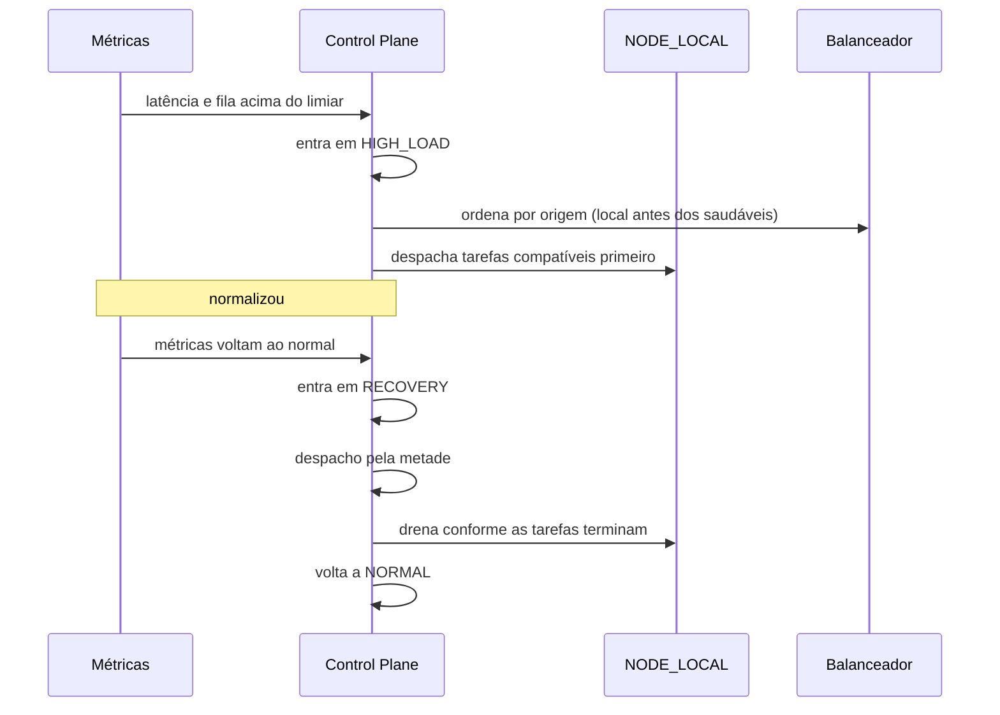

# 06 — Contingência

## 1. Modos operacionais

O modo é **dado do Control Plane**, não decisão de nó. Todo nó recebe o modo vigente no heartbeat
(campo `mode`) e, quando a config assinada existir, também nela.

| modo | quando | quem entra | o que muda |
|---|---|---|---|
| `NORMAL` | operação padrão | cálculo medido | tudo como hoje; despacho no teto da varredura |
| `HIGH_LOAD` | fila acima da capacidade | cálculo medido | **não** bloqueia nada: distribuição ampliada |
| `DEGRADED` | dependência crítica instável | admin, com motivo | **despacho novo parado**; trabalho em curso continua |
| `EMERGENCY` | infra principal indisponível | admin, com motivo | **despacho novo parado**; trabalho em curso continua |
| `RECOVERY` | voltando ao normal | admin, com motivo | **despacho pela metade**; sai sozinho quando a fila normaliza |

Duas origens de transição, e a diferença é o que impede o sistema de mentir para si mesmo:

- **Medido** (`NORMAL`, `HIGH_LOAD`): a razão fila/vagas cruza o limiar com histerese (entra em 1.0,
  sai em 0.5). Ninguém declara esses modos à mão — `POST /admin/network/mode` recusa com
  `NETWORK_MODE_NOT_MANUAL`, porque uma decisão "forçar NORMAL" seria desfeita na varredura seguinte.
- **Humano** (`DEGRADED`, `EMERGENCY`, `RECOVERY`): `POST /admin/network/mode` com motivo
  obrigatório, auditado em `NETWORK_MODE_<NOVO>` com ator, modo anterior e motivo. A automação
  **nunca** desfaz `DEGRADED`/`EMERGENCY` — ela não mede dependência externa, e encerrar o incidente
  de quem olhou é como o incidente volta.

`RECOVERY` é híbrido de propósito: começa por decisão humana e **termina por número**, quando a
fila volta abaixo do limiar de saída. Recuperação que depende de alguém lembrar de desligar vira
modo esquecido, com o despacho pela metade para sempre.

**O que exatamente muda no despacho:** `DEGRADED`/`EMERGENCY` designam zero tarefas na rodada;
`RECOVERY` designa metade do teto. O que já está designado continua com o nó — parar o despacho adia
trabalho novo, não cancela o que está na mão. A recuperação de tarefa órfã (claim vencido) roda em
**qualquer** modo: devolver à fila não é designar, e a órfã parada perderia o prazo esperando o modo
voltar.

### O que continua disponível em cada modo

| funcionalidade | NORMAL | HIGH_LOAD | DEGRADED | EMERGENCY | RECOVERY |
|---|---|---|---|---|---|
| login e sessão | sim | sim | sim | **não** (depende do banco) | sim |
| feed (leitura) | sim | sim | sim | cache de borda, se houver | sim |
| publicar | sim | sim | sim | não | sim |
| mensagens | sim | sim | sim | não | sim |
| mídia (leitura) | sim | sim | sim | sim (S3/CDN) | sim |
| mídia (upload) | sim | sim | sim | não | sim |
| moderação | sim | sim | sim | não | sim |
| tarefas assíncronas | sim | sim | adiadas | adiadas | retomando |

**Não se promete disponibilidade total quando dependência crítica está fora.** O modo `EMERGENCY`
existe para dizer com honestidade o que continua de pé.

## 2. Contingência local (prioritária)

**A prioridade do `NODE_LOCAL` é de ordenação, não de peso variável.** O escolhedor prefere o nó da
casa entre os saudáveis — depois do filtro de degradação, antes da folga. É constante e não depende
do modo: um pico não muda o critério, só aumenta o número de tarefas que passam por ele. Peso que
subisse e descesse traria um segundo conjunto de limiares para calibrar sem ganho observável — o
local já recebe primeiro até encher, e daí em diante a fila vai para os participantes de qualquer
modo.

O que o modo muda de fato é o **volume** despachado (`HIGH_LOAD` no teto da varredura, `RECOVERY`
pela metade), não a ordem. A drenagem completa — devolver trabalho ao participante sem derrubar o
que está em andamento — é o item "recuperação gradual" da fase 4, ainda aberto.

O local continua sujeito a todos os filtros: vivo, fora da janela de remoção, com vaga, não
saturado. Ele não ganha tipo de tarefa nem classe de dado que os outros não tenham — a permissão
dele vem do perfil, que já aceitava todos os tipos e é a única origem autorizada a receber dado que
não pode sair da infra autorizada. Prioridade de escalonamento é onde ele entra na ordem, não o que
ele pode tocar.

Critérios de entrada e saída são **medidos**, não intuídos: latência p95, profundidade de fila,
taxa de erro e uso de CPU/memória. Cada transição automática é registrada em auditoria com o número
que a motivou (`NETWORK_MODE_HIGH_LOAD` com `pending` e `capacity`; `NETWORK_MODE_NORMAL` na saída de
`RECOVERY`); cada transição manual guarda o motivo declarado.

O nó descobre o freio pelo heartbeat: `mode` e `acceptTasks` (falso em `DEGRADED`/`EMERGENCY`). Sem
esses dois campos a contingência existiria só no painel — o nó pediria tarefa no escuro e o
`EMERGENCY` não teria efeito nenhum em quem está executando.

## 3. Contingência distribuída

Nós externos previamente autorizados assumem funções emergenciais quando a região principal sofre
indisponibilidade.

Pré-requisitos, todos obrigatórios:

- replicação geográfica do que pode ser replicado (conteúdo público, cache, mídia);
- recuperação de configuração (config assinada versionada, disponível offline no nó);
- health check externo independente da região principal;
- failover de DNS ou da camada de roteamento;
- recuperação de filas (outbox replicada ou reconstruível);
- procedimentos de recuperação de dados documentados;
- **prevenção de split-brain**.

## 4. Anti split-brain

O Control Plane não pode ser ponto único de falha sem estratégia de recuperação. A estratégia é
**autoridade redundante com promoção controlada**:

1. Cada autoridade tem um `term` (contador monotônico).
2. Um nó aceita config apenas de `term` maior ou igual ao último visto; config de `term` menor é
   recusada e registrada.
3. Promoção exige quórum explícito de autoridades vivas; sem quórum, **ninguém promove** (fail
   secure: melhor ficar sem controlador do que ter dois).
4. Dois controladores com o mesmo `term` é impossível por construção (o term é atribuído na
   promoção, com compare-and-set no armazenamento compartilhado).
5. Nó que detecta dois controladores com termos diferentes entra em `QUARANTINED` e para de aceitar
   tarefas até a situação resolver.

## 5. Revogação durante processamento

Cenário: o nó está executando uma tarefa e é revogado.

1. Revogação grava `revoked_at` imediatamente.
2. O resultado que chegar depois é **descartado** (`NODE_REVOKED`), com registro em auditoria.
3. A tarefa volta para a fila e é redistribuída, com `attempt` incrementado.
4. Se a tarefa tinha efeito externo, a idempotência do handler impede duplicação.

## 6. Falha do Control Plane

| cenário | comportamento |
|---|---|
| Control Plane fora por < TTL de config | nós continuam com a última config assinada |
| fora por > TTL | nós param de aceitar tarefa nova e drenam as em andamento |
| volta | nós revalidam config e term antes de retomar |
| autoridade promovida | nós recebem config de term novo e revalidam |

Nó **nunca** inventa permissão quando o Control Plane está fora. Fail secure.

## 7. Testes obrigatórios de contingência

- nó indisponível no meio de uma tarefa → redistribuição sem duplicar efeito;
- revogação durante processamento → resultado descartado, tarefa redistribuída;
- Control Plane fora → nós drenam e param, sem aceitar tarefa nova;
- dois controladores com termos diferentes → nó entra em quarentena;
- sobrecarga simultânea → `HIGH_LOAD` entra e sai pelos números medidos;
- recuperação → `RECOVERY` drena sem derrubar o que está em andamento.
